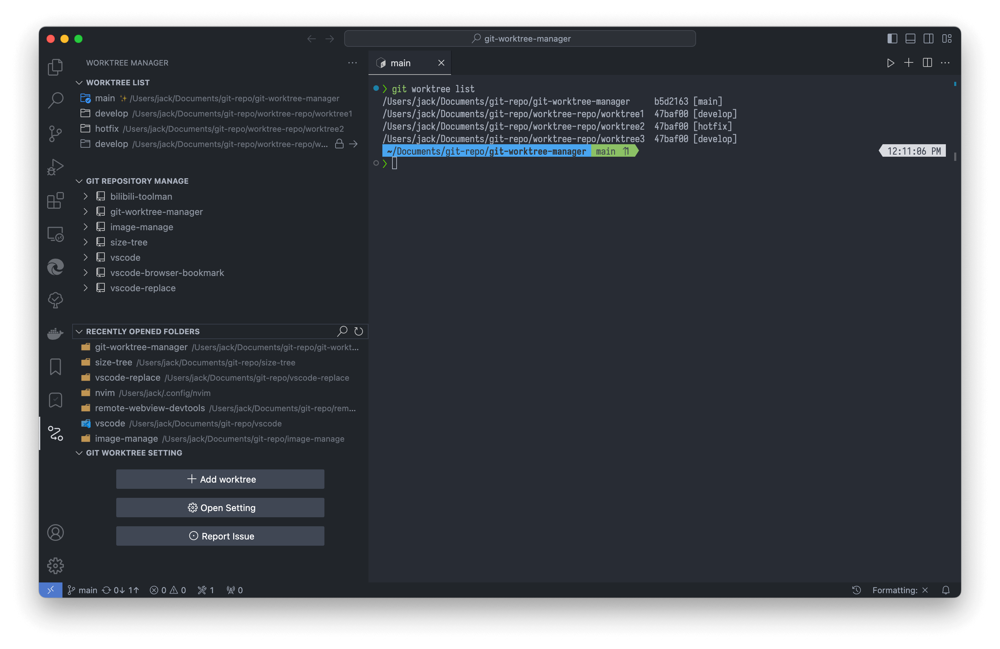

# VSCode Git Worktree Manager


[](https://marketplace.visualstudio.com/items?itemName=jackiotyu.git-worktree-manager)
[](https://open-vsx.org/extension/jackiotyu/git-worktree-manager)
[](https://github.com/jackiotyu/git-worktree-manager/releases)
[](https://github.com/jackiotyu/git-worktree-manager/issues)
[](https://github.com/jackiotyu/git-worktree-manager/blob/main/LICENSE)
[](https://github.com/jackiotyu/git-worktree-manager)

简体中文 | [English](./README.md)

**在 Visual Studio Code 中安全、高效地管理 Git worktree。**  
轻松创建、切换和清理 worktree，同时保持分支关系清晰可控。



## Support 💖

如果这个插件帮到了你，请点个 [star ⭐](https://github.com/jackiotyu/git-worktree-manager) 吧！

<table>
  <tr>
    <td align="center">
      <br/>
      <b>PayPal</b>
    </td>
    <td align="center">
      <br/>
      <b>微信</b>
    </td>
  </tr>
</table>

## 为什么选择 Git Worktree Manager？🌟

Git worktree 可以将不同分支隔离在独立目录中，让并行开发更加清晰，  
但在命令行中手动管理这些 worktree 往往繁琐且容易出错。

Git Worktree Manager 将 worktree 管理能力直接集成到 VS Code 中，  
帮助你安全地创建、切换和清理 worktree，同时保持仓库结构清晰可控。

<video src="./images/manage-multiple-repositories.mp4" controls="controls" width="800" height="450"></video>
> [在 VSCode 中轻松管理多个仓库。](./images/manage-multiple-repositories.mp4)

### 核心功能 🎯
- **快速切换 Worktree**：使用 `Ctrl+Shift+R` 或源代码管理视图快速切换 Worktree。 
  <video src="https://cdn.jsdelivr.net/gh/jackiotyu/git-worktree-manager@0.4.6/images/switch-branch.mp4" controls="controls" width="800" height="450"></video> 
  > [一键无缝切换分支。](https://cdn.jsdelivr.net/gh/jackiotyu/git-worktree-manager@0.4.6/images/switch-branch.mp4) 
- **轻松创建 Worktree**：无需命令行，直接在 VSCode 中创建 Worktree。 
  <video src="https://cdn.jsdelivr.net/gh/jackiotyu/git-worktree-manager@0.4.6/images/create-worktree.mp4" controls="controls" width="800" height="450"></video> 
  > [几秒钟内创建新 Worktree。](https://cdn.jsdelivr.net/gh/jackiotyu/git-worktree-manager@0.4.6/images/create-worktree.mp4) 
- **工作区集成**：将 Worktree 添加到 VSCode 工作区，轻松访问。 
  <video src="https://cdn.jsdelivr.net/gh/jackiotyu/git-worktree-manager@0.4.6/images/add-worktrees-to-workspace.mp4" controls="controls" width="800" height="450"></video> 
  > [一键将 Worktree 添加到工作区。](https://cdn.jsdelivr.net/gh/jackiotyu/git-worktree-manager@0.4.6/images/add-worktrees-to-workspace.mp4) 
- **收藏夹管理**：保存常用 Worktree，方便快速访问。 
  <video src="https://cdn.jsdelivr.net/gh/jackiotyu/git-worktree-manager@0.4.6/images/drop-to-favorites.mp4" controls="controls" width="800" height="450"></video> 
  > [将 Worktree 拖入收藏夹，随时访问。](https://cdn.jsdelivr.net/gh/jackiotyu/git-worktree-manager@0.4.6/images/drop-to-favorites.mp4) 
- **嵌套 Git 仓库**：执行 **选择嵌套的 Git 仓库** 扫描工作区内嵌套的 Git 仓库，多选要展示的仓库。可移除不再需要的仓库。
- **Worktree 分组**：将 Worktree 整理到本地可折叠分组中，不会修改 Git 元数据或仓库文件。
- **Worktree 排序**：使用 Worktree 列表标题栏中搜索图标旁的 **排序 Worktree** 下拉菜单，保持 Git 默认顺序（未分组的 Worktree 中主工作树排在最前），或选择按名称（A 到 Z / Z 到 A）或创建时间（最新 / 最早优先）排序。当前排序方式在菜单中显示为灰色且不可点击。选择会在重启后保留，并同样应用于组内的 Worktree。
- **复制未跟踪文件**：创建 Worktree 时自动复制主仓库的未跟踪文件。
- **多语言支持**：支持英语、简体中文、繁体中文和日语。
- **自定义终端**：支持 macOS 的 iTerm 或 Windows 的 Git Bash 等终端。

## 快速上手 🚀

1. **使用要求**
   - git version >= 2.40

1. **安装扩展**：
   - 从 [Visual Studio Marketplace](https://marketplace.visualstudio.com/items?itemName=jackiotyu.git-worktree-manager) 或者 [Open VSX Registry](https://open-vsx.org/extension/jackiotyu/git-worktree-manager) 下载。
   - 或在 VSCode 扩展视图中搜索 "Git Worktree Manager" 并安装。

1. **快速开始**：
   - 在 Git 仓库中打开 VSCode。
   - 按 `Ctrl+Shift+R` 启动 Worktree 管理器。
   - 使用直观界面创建、切换或删除 Worktree。

1. **示例工作流**：
   - 创建新 Worktree：选择“创建 Worktree”并指定分支。
   - 通过源代码管理视图或命令面板即时切换。
   - 将 Worktree 添加到 VSCode 工作区，同时处理多个分支。
   - 保存到收藏夹以便日后快速访问。

## 多仓库 Worktree

在主仓库根目录创建 `gwm.json`，或在 `.vscode/gwm.json` 中配置需要一起管理的子仓库。如果两个文件都存在，优先使用 `.vscode/gwm.json`：

```json
{
  "version": 1,
  "repo": {
    "packages/api": {
      "name": "api",
      "remote": "https://github.com/your-org/api.git"
    }
  }
}
```

`repo` 的键是子仓库在多仓库 Worktree 中使用的安全相对路径。`name` 用于在选择器中显示。可选的 `remote` 用于在子仓库源目录不存在时执行 clone，并在配置后校验现有仓库的远端。

可选的 `parent` 用于指定查找子仓库源目录的基准仓库根路径，支持绝对路径或相对于实际使用的 `gwm.json` 所在目录的路径。省略时，扩展会根据 Git 元数据推导主工作树根目录；使用 bare 仓库布局时则采用当前工作树。此属性不会改变负责管理多仓库 Worktree 的 Git 仓库。

需要打开多仓库 Worktree 管理器时，打开命令面板（`Ctrl+Shift+P` / `Cmd+Shift+P`），搜索并执行 **Worktree: 管理多仓库 Worktree**。

## 配置 ⚙️

根据你的工作流程自定义 Git Worktree Manager：

- **`git-worktree-manager.treeView.toSCM`**  
  在源码管理（Source Control）视图中显示 worktree。

- **`git-worktree-manager.treeView.worktreeDescriptionTemplate`**  
  自定义 worktree 在树视图中显示的描述文本，便于快速识别陈旧的 worktree。  
  可用变量：`$FULL_PATH`、`$BASE_NAME`、`$RELATIVE_PATH`、`$LAST_COMMIT`（最后一次提交的相对时间，例如 “3 周前”）。鼠标悬停可查看绝对时间戳。  
  **示例:** `"$RELATIVE_PATH · $LAST_COMMIT"`

- **`git-worktree-manager.treeView.worktreeLabelTemplate`**  
  自定义 worktree 在树视图中显示的标签（加粗文本）。留空则使用默认标签（分支名或标签名）。  
  可用变量：`$REF_NAME`（分支名或标签名）、`$BASE_NAME`、`$BASE_ROOT`（主仓库根目录的父目录）、`$FULL_PATH`、`$RELATIVE_PATH`、`$LAST_COMMIT`。  
  **示例:** `"$BASE_NAME ⇄ $REF_NAME"` 先显示文件夹名称，再显示分支名。

- **`git-worktree-manager.treeView.worktreeSortOrder`**

  设置 Worktree 列表的排序方式：`default`、`nameAsc`、`nameDesc`、`createdDesc` 或 `createdAsc`。适用于扩展侧边栏和源码管理视图，组内顺序不变。

- **`git-worktree-manager.worktreeCopyPatterns`**  
  指定在创建新 worktree 时需要复制的文件或目录  
  （例如本地配置文件或环境相关资源）。  
  **示例:** `[".env.local", "config/*.json"]`

- **`git-worktree-manager.nestedRepoScanIgnores`**  
  扫描工作区中的嵌套 Git 仓库时要跳过的目录和文件 glob 模式。内置的 `node_modules` 和 `.git` 元数据排除规则始终生效。  
  **示例:** `["**/vendor/**", "**/generated/**"]`

- **`git-worktree-manager.worktreeCopyIgnores`**  
  在创建 worktree 时排除某些文件或路径，即使它们匹配 `worktreeCopyPatterns`。  
  **示例:** `["node_modules", "dist"]`

- **`git-worktree-manager.postCreateCmd`**  
  在创建 worktree 后自动执行的命令  
  （例如安装依赖或运行初始化脚本）。  
  **示例:** `"pnpm install"` 或 `"echo 'Worktree 已就绪'"`

- **`git-worktree-manager.preRemoveCmd`**  
  在删除 worktree 前自动执行的命令  
  （例如清理 worktree 产生的副作用，如每个 worktree 专属的数据库 schema，或停止服务）。  
  命令在 worktree 目录内执行。若命令失败或被取消，则中止删除。  
  **示例:** `"pnpm run worktree:teardown-db"`

- **`terminal.external.windowsExec`**  
  设置 Windows 系统下的外部终端  
  （例如 Git Bash: `"C:\\Program Files\\Git\\bin\\bash.exe"`）。

- **`terminal.external.osxExec`**  
  设置 macOS 系统下的外部终端  
  （例如 iTerm: `"iTerm.app"`）。

## 贡献 🤝

我们欢迎贡献！参与方式：
1. 克隆仓库。
2. 创建功能分支（`git checkout -b feature/awesome-idea`）。
3. 提交更改（`git commit -m "添加新功能"`）。
4. 推送分支（`git push origin feature/awesome-idea`）。
5. 提交 Pull Request。

有好主意？请在 [issues](https://github.com/jackiotyu/git-worktree-manager/issues) 中创建“enhancement”标签的问题。

## 许可证 📜

采用 [MIT 许可证](LICENSE) 分发，欢迎自由使用、修改和分享！
